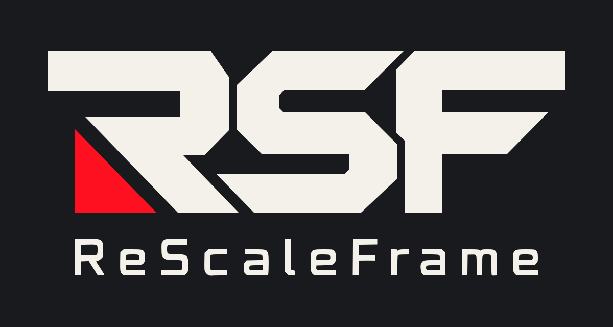

<p align="center">
  <picture>
    <source media="(prefers-color-scheme: dark)" srcset="assets/branding/ReScaleFrame-logo-transparent.svg">
    <source media="(prefers-color-scheme: light)" srcset="assets/branding/ReScaleFrame-logo-black-transparent.svg">
    
  </picture>
</p>

<h1 align="center">ReScaleFrame</h1>

<p align="center"><strong>Engine-aware upscaling, frame generation and latency integration.</strong></p>

<p align="center">
  <a href="https://github.com/KillerPixelCrew/ReScaleFrame/releases">Downloads</a> ·
  <a href="#games-and-downloads">Games</a> ·
  <a href="#build-and-contribute">Build and contribute</a> ·
  <a href="https://github.com/KillerPixelCrew/ReScaleFrame/issues">Report an issue</a>
</p>

ReScaleFrame brings DLSS, FSR and XeSS into games through integrations that understand the
engine's rendering pipeline. Each integration supplies scene colour, depth, motion and the
right composition boundaries. A shared native runtime handles vendor SDKs, graphics resources,
settings and presentation.

A [KillerPixelCrew](https://github.com/KillerPixelCrew) project.

## Games and downloads

Choose your game's package and guide. Requirements, available features and validation differ
between integrations.

| Game | Available now | Download and guide |
| --- | --- | --- |
| **Minecraft / ReScaleFrameCraft** | Minecraft 1.21.1, NeoForge and Sodium; temporal antialiasing, native reconstruction and independent frame-generation selection | [1.1.9 release](https://github.com/KillerPixelCrew/ReScaleFrame/releases/tag/minecraft-v1.1.9) · [Installation and controls](games/minecraft/RELEASE.md) |
| **Ace Combat 7** | Stable SR release; 0.1.1 preview adds current FG/latency code | [0.1.1 preview](https://github.com/KillerPixelCrew/ReScaleFrame/releases/tag/ac7-v0.1.1) · [Stable 0.1.0](https://github.com/KillerPixelCrew/ReScaleFrame/releases/tag/v0.1.0) · [AC7 guide](games/ac7/README.md) |
| **Drag'n Wash / Unity Mono** | SR, shared overlay and FG switching in source and local test builds | [Game guide](games/drag-n-wash/README.md) · [Unity adapter](games/unity-mono/README.md) |
| **Project Wingman** | Renderer research only; GPU processing remains unimplemented | [Research and status](games/project-wingman/README.md) |

**A source feature is not necessarily included in a published package.** AC7's published
0.1.0 ZIP is SR-only and excludes the later FG/Reflex work on `main`. Unity packages remain
local test builds. For Minecraft, the release guide describes 1.1.9; development notes also
cover later changes.

The 0.1.1 AC7 download is a prerelease without fresh gameplay acceptance.
It includes current SR/FG/latency code. Project Wingman has no published package. See the
[build evidence and package limits](docs/releases/v0.1.1-windows.md).

### Minecraft

Install **Minecraft 1.21.1**, **NeoForge 21.1.262 or newer in the 21.1 line**, and
**Sodium 0.8.13**. Java 21 or newer is required. Native reconstruction and FG need Windows x64,
compatible OpenGL external Win32 memory/semaphore support and D3D12 on the same GPU.

1. Close Minecraft, remove older ReScaleFrameCraft JARs and disable MetalUpscaler.
2. Download `rescaleframecraft-1.1.9.jar` from the release above and place it in the instance's `mods` folder.
3. Launch normally. Native runtimes and their notices extract automatically.
4. Open **Video Settings > ReScaleFrame**. **F8** opens temporal settings; **F3** shows processing status.

SR provider, quality, FG provider/count and low-latency settings apply while running.
Settings persist in `config/rescaleframecraft.json`. Reese's Sodium Options 2.2.4 is supported.

Version 1.1.9 adds Iris/Colorwheel improvements, Flywheel/Create motion history and DLSS model
presets. Shader-pack behaviour and motion coverage still vary. This is a client mod.
See the [release guide](games/minecraft/RELEASE.md), [native integration](games/minecraft/NATIVE.md)
and [motion coverage](games/minecraft/MOTION.md).

### Ace Combat 7

The published package targets Steam AC7 on Windows 10/11 x64, tested executable build
**9855922**.

1. Close AC7 and download `ReScaleFrame-0.1.0-AC7-Windows-x64.zip`.
2. Find `Ace7Game.exe` through Steam's **Manage > Browse local files**.
3. Extract the complete package beside the executable.
4. Launch normally and press **Insert** to choose the upscaler and quality preset.

Menus, HUD and briefing render at output resolution. Native quality uses DLAA with DLSS.
If another mod uses `dinput8.dll`, follow the [installation guide](docs/releases/ac7-install.md)
before changing files; proxy chaining is unsupported.

## Features and hardware

- **Super resolution and antialiasing:** DLSS/DLAA, FSR and XeSS, with quality modes supplied by the selected SDK.
- **Frame generation:** independent DLSS-G, FSR3/4 and XeSS FG selection in current integrations, with provider-specific limits and live replacement.
- **Latency integration:** Reflex/PCL and XeLL services where supported by the host and provider.
- **Engine-aware composition:** scene reconstruction and HUD-less FG inputs have separate boundaries, preserving UI composition.
- **Runtime controls:** the shared Insert overlay for AC7/Unity and native Minecraft settings.

DLSS requires supported NVIDIA RTX hardware. Other providers and generated-frame counts depend
on the GPU, driver, SDK and game integration. FSR4 SR compatibility does not establish FSR4 FG
support. Unsupported requests report their status; check the effective provider in the game's UI.

Recorded acceptance covers particular builds, hardware and rendering paths. Higher presented FPS
does not by itself establish lower latency or better frame pacing. AC7 has remaining lighting and
motion-coverage work; Unity needs broader scene and hardware coverage; Minecraft has incomplete
motion coverage for some shader-driven geometry. Project Wingman has no SR, FG, latency or VR
processing.

See [AC7/Unity runtime status and evidence](docs/current-status.md) and the game guides above.
The native game-plugin APIs retain conservative `rendering_ready = 0` flags despite acceptance
of individual AC7 and Unity paths.

## How it works

Game integrations own executable detection, hooks, camera and motion conventions, render
resolution and output reinsertion. The shared runtime owns vendor contexts, plugin lifecycle,
graphics interoperability and presentation. The [MIT Game SDK](sdk/game/) defines the versioned
native C ABI between them.

SR uses scene data before tonemapping or other integration-specific post-processing boundaries.
FG uses a completed display-size frame and matching temporal inputs. Keeping those inputs
separate lets UI and translucent effects retain their own composition paths.

AC7 enters through a DirectInput carrier, Unity through a version shim, and Minecraft through
its Java/native adapter. The standalone launcher and bootstrap remain scaffolds; WSGM and
frontend IPC remain planned.

[Design](docs/design.md) · [Architecture research](docs/research/architecture.md) ·
[Vendor FG contracts](docs/research/vendor-fg-contracts.md)

## Build and contribute

Windows/MSVC is the reference native platform. Install Visual Studio C++ tools, a Windows SDK,
CMake, PowerShell and the Rust toolchain pinned in `rust-toolchain.toml`.

```powershell
./eng/verify.ps1 -Configuration Release
cargo test --workspace --locked
cargo build --release --locked -p rescaleframe-overlay
```

Add `-VS2026` to the verification command for Visual Studio 2026; the default uses 2022.
The gate builds and tests native code, checks version alignment and runs Rust formatting and
Clippy. Rust tests run separately. Verification does not launch or modify a game.

Shared native outputs land in `build/windows-x64/bin/Release`; the dedicated AC7 carrier is
`build/windows-x64/ac7/bin/Release/dinput8.dll`. Rust outputs land in `target/release`.

Vendor SDKs are optional local dependencies. Builds without the relevant headers report that
backend as unavailable. Unity also needs .NET, Unity native headers and the researched player's
Managed assemblies. Minecraft requires its native staging and Gradle steps.

- [Repository instructions and cross-build route](AGENTS.md)
- [Dependencies and packaging](docs/dependencies.md)
- [Development tools](docs/tooling.md)
- [Minecraft build instructions](games/minecraft/NATIVE.md)
- [Unity build instructions](games/unity-mono/README.md)
- [Implementation tracker](docs/implementation.md)

Contributions should name the problem, explain the change and record checks or rendering evidence.
Distinguish source review, automated tests, device execution and live game acceptance.
Executable recognition alone does not prove rendering support. Keep licensed engine/game source,
vendor binaries and raw captures outside Git.

### Repository map

| Directory | Purpose |
| --- | --- |
| [`games/`](games/) | Game integrations, build guides and evidence |
| [`runtime/`](runtime/) | Shared orchestration, vendor backends, graphics and presentation |
| [`loader/`](loader/) | Carriers, bootstrap and loading diagnostics |
| [`sdk/game/`](sdk/game/) | Public native Game SDK |
| [`ui/overlay/`](ui/overlay/) | Shared in-game settings overlay |
| [`apps/launcher/`](apps/launcher/), [`integrations/wsgm/`](integrations/wsgm/) | Frontend scaffolding |
| [`tests/`](tests/), [`tools/`](tools/), [`docs/`](docs/) | Verification, analysis and documentation |

## Troubleshooting

Start with your game's guide. Include the package version or source commit, GPU and driver,
chosen SR/FG providers, quality preset, output resolution and steps to reproduce in
[an issue](https://github.com/KillerPixelCrew/ReScaleFrame/issues).

For Minecraft, include `logs/latest.log` and the active payload's
`rescaleframe/native/<payload>/minecraft-native.log`. AC7 logs are under
`%LOCALAPPDATA%\ReScaleFrame\AC7\`. Installation, update and removal details belong to each
game's guide.

## Brand assets

Original SVGs: [graphite background](assets/branding/ReScaleFrame-logo.svg) ·
[off-white on transparent](assets/branding/ReScaleFrame-logo-transparent.svg) ·
[black on transparent](assets/branding/ReScaleFrame-logo-black-transparent.svg).

The header selects the transparent variant for GitHub's light or dark theme.

## License

First-party code and documentation use [GPL-3.0-only](LICENSE), except the
[MIT-licensed Game SDK](sdk/game/LICENSE). Third-party components and vendor runtimes retain
their own licenses and notices. Game binaries and licensed engine source are not distributed.
