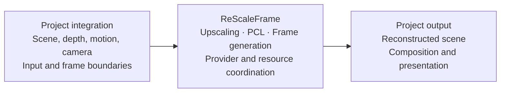

  <picture>
    <source media="(prefers-color-scheme: dark)" srcset="assets/branding/ReScaleFrame-logo-transparent.svg">
    <source media="(prefers-color-scheme: light)" srcset="assets/branding/ReScaleFrame-logo-black-transparent.svg">
    
  </picture>

<h1 align="center">ReScaleFrame</h1>

<strong>Multi-vendor upscaling, PCL and frame-generation orchestration.</strong>

  <a href="https://github.com/KillerPixelCrew/ReScaleFrame/releases">Game releases</a> ·
  <a href="#pipe-in-pipe-out">The framework</a> ·
  <a href="#the-framework-in-use">Integrations</a> ·
  <a href="https://github.com/KillerPixelCrew/ReScaleFrame/issues">Issues</a>

ReScaleFrame is a **pipe-in, pipe-out framework** for bringing vendor rendering technology into
an engine, renderer or project. Once the right inputs and output boundaries are identified,
the integration connects them to a shared orchestrator for upscaling, frame generation and
PC latency (PCL).

The engine knowledge stays in the integration. Provider selection, SDK contexts, temporal
processing, latency coordination and presentation transitions belong to ReScaleFrame. That
makes the work reusable: a new project supplies its rendering data and host operations to
the framework rather than rebuilding the orchestration around each vendor SDK.

A [KillerPixelCrew](https://github.com/KillerPixelCrew) framework.

## Pipe in, pipe out

The input is more than a texture. Temporal processing needs matching colour, depth, motion,
camera matrices, jitter, render/output dimensions and history-reset information. Input,
simulation, rendering and presentation also need to refer to the same source frame.

ReScaleFrame connects those inputs to NVIDIA DLSS/DLAA and DLSS-G, AMD FSR, Intel XeSS,
and the corresponding latency and pacing services. SR and FG can be selected independently.
The available algorithms, generated-frame counts and latency features follow the chosen
backend, graphics path and hardware.

The output returns at the project's own composition or presentation boundary. SR consumes
scene inputs at the reconstruction point; FG consumes the completed scene and its matching
temporal guides, with HUD-less and UI inputs where the integration supplies them.
Those are separate stages with different inputs and lifetimes.

### What the integration supplies, and what the framework owns

| Integration | ReScaleFrame |
| --- | --- |
| Scene/depth/motion producers and camera conventions | Provider input preparation and SDK evaluation |
| Engine hooks or renderer callbacks | Vendor contexts, capability checks and provider selection |
| Input, simulation and render boundaries | PCL markers, frame tokens and provider pacing |
| Renderer resources and their completion/retirement operations | Coordination of temporal history and provider resource lifetimes |
| Composition targets and presentation operations | Reconstructed output, FG eligibility and presentation-provider transitions |

This boundary exists in both the [native runtime](runtime/orchestrator/) and the
[managed Vulkan runtime](runtime/managed/ReScaleFrame.Vulkan/). The native path uses
[versioned C ABI contracts](sdk/game/); the managed Vulkan path uses
[temporal contracts](runtime/managed/ReScaleFrame.Contracts/) and renderer host interfaces.

The implementation includes provider planning, requested/effective state, failure reporting,
history resets, resource retirement and live provider changes. The renderer remains responsible
for the resources and operations exposed through its host interface.

## The framework in use

### Red Dead Redemption 2: integration in progress

The forced-DX12 ASI and gameplay input census are implemented. RSF SR/FG execution
remains pending. See the [RDR2 integration guide](games/rdr2/README.md).

### Minecraft: modern vendor processing behind an OpenGL renderer

ReScaleFrameCraft connects Minecraft's Java/OpenGL renderer to ReScaleFrame's native runtime.
The adapter supplies scene colour, depth, motion, camera state and frame boundaries.

The [OpenGL sharing layer](runtime/presentation/src/gl_shared_surface.cpp) imports shared
D3D12 resources as OpenGL textures and synchronizes access through shared fences and
semaphores. The [GL pipeline](runtime/orchestrator/src/gl_pipeline.cpp) passes those resources
to the D3D12 SR/FG paths and exposes reconstructed output back to OpenGL.

That bridge brings technology requiring D3D12 into Minecraft's OpenGL rendering path.
Minecraft composes its HUD after scene reconstruction and supplies a separate HUD-less
image for FG. When native presentation is active, a child DXGI surface owns presentation
inside the game window while GLFW retains input and focus ownership.

The game integration identifies and produces the inputs. The framework handles the
vendor processing and the graphics-API boundary.

### Ace Combat 7: modern temporal technology in an older engine

AC7's integration brings modern upscaling and frame generation into its existing UE4/D3D11
rendering pipeline. Native hooks expose the engine's scene, camera, depth, motion and
composition boundaries, and prepare the renderer to supply the data those technologies need.

The [native bridge](loader/proxy/src/dlss_bridge.c) routes scene passes into ReScaleFrame's
SR processing and carries CPU, scene, UI and window events into the shared FG/latency paths.
The D3D11/D3D12 presentation bridge provides the route to SDKs that require D3D12.

Reconstructed scene output is reinserted into the engine's frame. UI and translucent
composition keep their own boundaries. The AC7 code owns the engine-specific hooks and
rendering corrections; the shared runtime owns the vendor processing, frame association
and presentation coordination.

### Drag'n Wash: connecting Unity URP to the same runtime

The Unity Mono adapter connects URP RenderGraph to ReScaleFrame through a managed helper
and Unity's native rendering interfaces. The helper identifies the reconstruction and
pre-UI stages, produces camera/temporal packets and queues native render events.

The [native Unity bridge](games/unity-mono/src/bridge.cpp) validates those packets, retains
their resources and forwards the passes to the shared runtime. SR runs before DoF, bloom
and tonemapping; completed scene colour is captured before UI for FG. Player-loop callbacks
supply the CPU frame boundaries used by latency coordination.

Unity supplies a different engine integration while reusing the runtime's vendor backends,
SR/FG selection, overlay and presentation services.

### VulkanStory: ReScaleFrame inside a Vulkan renderer

[VulkanStory](https://github.com/KillerPixelCrew/VulkanStory) uses ReScaleFrame as its temporal
technology orchestrator. Its renderer references `ReScaleFrame.Contracts` and
`ReScaleFrame.Vulkan` from the pinned ReScaleFrame submodule.

VulkanStory's
[upscaling adapter](https://github.com/KillerPixelCrew/VulkanStory/blob/HEAD/src/VulkanStory.Game/RuntimeUpscalers.cs)
supplies scene targets and temporal data to ReScaleFrame's `UpscalerSession`.
Its frame-generation adapter supplies scene, UI, motion and camera inputs; the renderer
implements the resource and presentation operations required by the framework's host interfaces.

ReScaleFrame's managed Vulkan runtime owns SR provider planning/evaluation,
`FrameGenerationSession`, and `LatencySession`. Those controllers coordinate vendor
contexts, current-frame eligibility, PCL/Reflex/XeLL and other supported latency paths,
provider transitions and generated-frame pacing. VulkanStory owns the game rendering and
the Vulkan resources those controllers use.

This is the same integration model embedded in a renderer: **identify the inputs and
outputs, connect the host, and let ReScaleFrame orchestrate the vendor technology.**

## Releases and implementation

[Game releases](https://github.com/KillerPixelCrew/ReScaleFrame/releases) contain installation
instructions, controls, requirements and package-specific information.

[Design](docs/design.md) · [Native contracts](sdk/game/include/rescaleframe/) ·
[Vulkan provider runtime](runtime/managed/ReScaleFrame.Vulkan/) ·
[Vulkan native bridges](runtime/vulkan/) · [Implementation record](docs/implementation.md)

## License

First-party code is [GPL-3.0-only](LICENSE), except the [MIT Game SDK](sdk/game/LICENSE).
The [managed Vulkan migration](runtime/managed/NOTICE.md) retains its original notices and
license terms. Vendor runtimes and other dependencies retain their own licenses.
