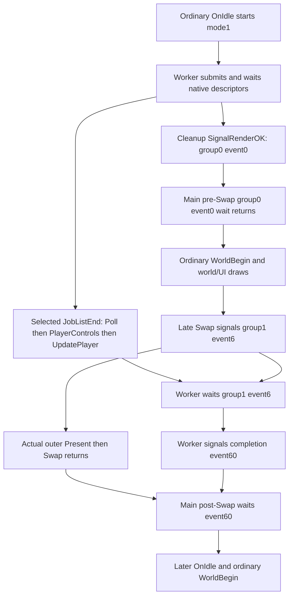

# Fallout 4 native CPU ownership, 16 November 2026

This investigation asks where the installed engine polls input, consumes it,
updates simulation and renders a source that reaches actual Present. Native
instructions were checked against the source leads in
[the render integration investigation](fallout4-render-integration-20261116.md)
because the reference's latency markers alone cannot establish these facts.
This is static shipped-binary analysis and source review, not a runtime test.

## Identity and method

The installed `Fallout4.exe` is 1.11.240.0, SHA256
`fdcef37ac1230af6d0b0050eb2142b139ef3a867b37b9211fb6edfcc646072f8`.
All addresses below are RVAs against this image, whose preferred base is
`0x140000000`. ASLR requires adding the actual module base at runtime.
Source revisions are Community Shaders
`e0e711594291c1a8e447ac758099492514810fbb`, CommonLibF4
`7f8deca16dc7dd245c9c52151ec9ef27edd9ad60` and commonlib-shared
`5408d22adf937cc00e0ccd4bdeef66021172884d`.

Capstone 5.0.7 and pefile inspected the installed PE directly. The old
1.11.221 address database supplied search neighborhoods only. No old RVA
was used as an activation address. The `.pdata` entries split some functions
into fragments, so a fragment entry is not automatically a function entry.
Shared Ghidra/REA/IDA sessions were not touched. No game, build, test,
deployment or commit was performed by this worker.

Local receipts under `.local/fallout4-research/` are `cpu-c314f0.txt`,
`cpu-c336b0-full.txt`, `cpu-c339d0-full.txt`, `cpu-c33000.txt`,
`cpu-1672540-full.txt`, `cpu-166e110-full.txt`, `cpu-10372a0-full.txt`,
`cpu-input-xrefs.txt` and the corresponding `cpu-*.py` scripts. These are
untracked analysis receipts, not runtime dependencies. The supplied F4SE
0.7.9 source archive's `GameInput.cpp/h` gives an independent singleton/layout
lead; its archive fingerprint is recorded in the linked investigation.

## Native loop and render ownership

| Boundary | Installed instructions | Interpretation |
| --- | --- | --- |
| Main::Run | entry `c314f0`; `c3151e: e8 8d 21 00 00` calls `c336b0` | Matches AE source Run+2e -> WindowsMessageLoop |
| Conditional idle | `c315bb: e8 10 24 00 00` calls `c339d0` | OnIdle is conditional, not every message-loop iteration |
| Main::Swap | `c346ac: e8 9f eb ff ff` calls `c33250`, return `c346b1` | Matches OnIdle+cdc; synchronous render source scope |
| World/UI path | `c33434: e8 07 4e 00 00` calls `c38240` after `c3342a` calls `c38e30` | Swap contains world/UI work, so its entry is not render-submit after simulation |
| Render_UI | `c383c2`, `c39d6a`, `c39e0e` call `21fa200` | Normal path plus both DrawGamePause paths, as independently established by coordinator |
| Late Swap work | `c335db` calls `17eeed0` | Callee ownership and actual Present are not yet proved by this worker |

Main::Run reads the native main singleton at `32dd130`. Its native HWND is
read from Main+30 before foreground-window comparison. The loop can take a
background branch with an existing native sleep and skip OnIdle. It checks
quit/reset flags after that branch and loops back to `c31510`. These sleeps
are existing game behavior, not an RSF pacing implementation.

OnIdle writes Main+1d0 from a native menu-related count at entry and tests
Main+2a repeatedly. This supports the CommonLib `inMenuMode` and `freezeTime`
layout leads but does not identify all UI/menu states or prove that every
simulation subsystem is frozen. OnIdle continues work after Swap returns,
through its return at `c3494b`. Therefore a Swap source is a rendered source,
not the whole OnIdle update. Do not label that scope simulation begin/end.

## Windows messages are distinct from polling

The `c336b0` routine calls imported `PeekMessageA` at `c338e4` and `c33918`,
with PM_REMOVE=1 and null HWND/filter arguments. The loop calls
`TranslateMessage` at `c338f4` and `DispatchMessageA` at `c338fe` before the
next PeekMessage. This proves native dequeuing/dispatch ordering. It does not
prove that a dispatched WM message caused a keyboard, mouse or controller
sample for the next world update. A second small pump at `c33950` likewise
does not establish physical sampling.

The reference TemporalPipeline emits simulation/input markers after its
WindowsMessageLoop wrapper. That remains reference marker policy. RSF must
not emit INPUT_SAMPLE or SIMULATION_BEGIN there. A future native message
reporter can report the actual dequeued ID, without key/button contents,
through INPUT_EVENT/WINDOW_MESSAGE after proving the MSG lifetime and hook
ABI. No such hook is installed here.

## Actual native device polling

OnIdle loads the float delta in XMM1 at `c342a6`, loads the input manager
singleton from `3e75cb8` at `c342ae` (`48 8b 0d 03 1a 24 03`) and calls
`1672540` at `c342b5` (`e8 86 e2 a3 00`), returning to `c342ba`.
The dispatcher ABI is `void(manager*, float)`, x64 RCX/XMM1.

Its instructions establish the dispatcher independently of the source marker:

| RVA | Bytes | Native fact |
| --- | --- | --- |
| `1672540` | `48 83 ec 38` | Stack entry |
| `1672544` | `80 79 35 00` | Tests manager pollingEnabled+35 |
| `1672550` | `74 40` | Disabled branch skips every device poll |
| `1672557` | `48 8d 59 08` | First device pointer at manager+8 |
| `1672560` | `bf 05 00 00 00` | Five entries |
| `1672565..167256b` | `48 8b 0b 48 85 c9 74 09` | Null devices skipped |
| `167256d..1672573` | `48 8b 01 0f 28 ce ff 50 08` | Device vtable slot1 receives float delta in XMM1 |
| `1672576..167257e` | `48 83 c3 08 48 83 ef 01 75 e5` | Advances one pointer until all five visited |
| `1672583` | `e8 88 bb ff ff` | Calls `166e110` after device poll loop |
| `167259b` | `c3` | Dispatcher returns |

Pinned CommonLib `BSInputDeviceManager.h` names the five entries keyboard,
mouse, gamepad, debug gamepad and virtual keyboard; `BSInputDevice.h` names
slot1 `Poll(float)`. The native +8 array and +35 gate agree exactly.
This is proof of the dispatcher calling device poll methods. It is not yet
proof of which physical API each implementation calls, which devices deliver
events on this invocation, or where the resulting queue/control state is
consumed by gameplay and menus.

The trailing `166e110` is a locked float/time-list processor, including an
existing contention Sleep. Its proximity does not establish an input event
consumer. Following OnIdle call `10372a0` is a short tail wrapper to `1673ae0`;
its arguments and consumer behavior remain unresolved. These are retained
leads, not a claimed source binding or completed simulation boundary.

## Initial rendered boundary contract

`games/fallout4/src/cpu_events.cpp/h` supplies one guarded rendered-source
scope. It detours native Swap `c33250` with `void(Main*)`, admitting only the
verified OnIdle return address `c346b1`. Activation checks the call bytes
above and entry bytes
`48 89 5c 24 08 57 48 81 ec 40 01 00 00`.
The caller must first verify the exact executable fingerprint, initialize
MinHook, supply size-checked host services and preserve module/callback
lifetime. A byte mismatch refuses activation; the lifecycle owner must log
the refusal. Source code is provided, not built or activated in this task.

At synchronous admitted entry the reporter creates a monotonic source ID and
reports FRAME_BEGIN; after unchanged Swap returns it reports FRAME_END.
QPC timestamps are measured at those callbacks with their frequency, never
backdated to a presumed input or simulation time. The current identity is
thread-local and only usable during that call. A verified primary renderer
calls `begin_cpu_render()` once and copies `current_cpu_identity()` into its
leased resources. The render association ID is not an ExecuteCommandLists
event. FRAME_END reports one primary renderer only after that producer has
registered, otherwise RENDER_SKIPPED. The adapter must not use host.submit
to describe a DX11 world draw or Swap entry.

The runtime owns missing-stage derivation and rendered provenance admission.
At this initial stage no INPUT_KEYED, INPUT_SAMPLE, prospective reservation,
simulation stage, vendor marker, pacing sleep or input capability was emitted.
The later prospective implementation below supersedes the reservation absence.
Root owns wiring
the functions into lifecycle/render hooks and validating that actual outer
Present and the WINDOW lease carry the same source. The scope does not
authorize caching textures, camera state or immediate-context work after its
lease ends. Pause paths outside the selected caller have no source until
their separate ownership is proved; never borrow the last world source.

## Remaining proof and activation limits

For full latency, trace concrete keyboard/mouse/controller Poll implementations
to the physical APIs and their event/state producers, then the queue drain
and gameplay/menu consumers. Prove whether an intervening poll or worker can
replace sampled state, including loading, VATS, inactive, menu and pause paths.
The later implementation selects RESERVE/SAMPLED/BIND/ABORT from the existing
versioned event contract, without claiming complete simulation coverage.
RESERVE runs before the native poll, and SAMPLED
must carry QPC taken after RESERVE returns immediately before the unchanged
poll. A skipped pollingEnabled branch cannot claim produced input.

Simulation begin/end and actual render submission remain unresolved. Trace
Swap's late callee `17eeed0` and the actual outer chain Present separately;
FRAME_END is CPU scope closure, not GPU completion or successful Present.
F4SE callback/trampoline and ENB pre/post-Present work must remain in native
order. Public capabilities and readiness remain refused until producer
coverage and the coordinator's required checks exist. Source review does not
establish measured latency, SR/FG quality or F4SE/ENB runtime acceptance.

## Follow-up: acquisition, queue consumption and redraw ordering

The follow-up dispatch continued static analysis after the initial source
freeze. The earlier statement that the queue consumer was unresolved is
superseded for the dispatcher and the concrete PlayerControls receiver below.
It remains unresolved for the simulation source that owns the effects of
those controls. Additional local receipts are `cpu2-*.txt`,
`cpu2-physical-api-xrefs.json`, `cpu2-vtables.json` and `cpu2-xrefs.json`.

### Keyboard and mouse acquisition precedes buffered Poll

Native window procedure `c3a5f0` has the x64 WNDPROC ABI
`LRESULT(HWND,UINT,WPARAM,LPARAM)`, keeping the message in ESI and LPARAM in
RDI. Its `WM_INPUT` (0xff) branch leads to `c3a8ba`. It queries
`GetRawInputData` at `c3a8fe`, then obtains RAWINPUT at `c3a945`, both with
RID_INPUT=0x10000003 and header size0x18. For dwType0 it calls mouse handler
`16754d0` at `c3a96b`, bytes `e8 60 ab a3 00`, return `c3a970`; for dwType1
it calls keyboard handler `1675140` at `c3a98d`, bytes `e8 ae a7 a3 00`,
return `c3a992`. Both handlers use `void(device*,const RAWINPUT*)` in
RCX/RDX and return without a value consumed by the caller.

Keyboard handler `1675140` starts
`48 89 5c 24 10 48 89 6c 24 18`. After raw-key mapping it writes device+170
at `16751f1`. Mouse handler `16754d0` starts
`0f b7 42 1c a8 01 74 08`; it updates button bits+71 and wheel+72, then
accumulates relative mouse motion into+74/+78 at `167557a`/`1675580`.
These are actual native receipt/buffer-write boundaries, not hypothetical
hardware timestamps. The previously identified five-device Poll dispatcher
later consumes those buffers. In particular, keyboard Poll compares+70/+170,
while mouse Poll emits movement from+74/+78 and clears the accumulated deltas.

The distinction matters: a marker before buffered Poll measures the engine's
poll boundary, not the time the physical keyboard or mouse was sampled by the
OS. Do not describe the former as a direct hardware API sample. Events can
also arrive through other native paths, which are not yet all covered.

The CPU reporter now additionally detours these two RAWINPUT handlers, checks
their exact entry/call bytes and selects only the native return addresses
above. It reports INPUT_EVENT with source0, INPUT_UNFRAMED and the received
keyboard/mouse kind, without retaining keys, buttons or payloads. This does
not claim which engine source consumes the event. The unchanged native
handler still runs with original arguments and LastError. Prepare/start/stop
manage these hooks with the existing Swap hook, including partial setup
cleanup. No runtime execution is claimed for this addition.

### Controller samples inside its native Poll

PE RTTI complete-object-locator and vtable inspection establishes these
offset0 vtables and entries, rather than assuming source IDs resolve:

| Native class | Vtable RVA | Poll/receiver entry |
| --- | --- | --- |
| BSPCKeyboardDevice | `267e800` | slot1 `1674fe0` |
| BSPCMouseDevice | `267e838` | slot1 `1675350` |
| BSPCGamepadDeviceHandler | `267efc0` | slot1 `16771b0` |
| BSPCGamepadDevice | `267f0b8` | slot1 `16777f0` |
| BSPCGamepadDeviceDelegate | `267f040` | slot1 `1677620`, a no-op return |
| PlayerControls | `2571a30` | slot0 `ddbe50` |
| MenuControls | `25b1ca8` | slot0 `1074af0` |

Handler `16771b0` selects/delegates through device+b0, checks connection and
calls the selected device's slot1. Concrete gamepad Poll `16777f0` saves its
previous state, passes user index ECX and state destination device+e0 in RDX
to `1677bb7` at `1677847`, and tests EAX at `167784c`. A nonzero result
skips event generation. Thunk `1677bb7`, bytes `ff 25 53 93 dc 00`, jumps
through IAT `2440f10`, imported from `XINPUT1_3.dll` ordinal2. The installed
System32 DLL's export table names ordinal2 `XInputGetState`, establishing the
physical API locally. This poll differs from keyboard/mouse buffered Poll.
No controller hook or controller-reception counter is implemented here:
successful state retrieval alone does not prove a new delivered user event.

### Queue-to-player consumption is synchronous

OnIdle after Poll calls `10372a0`, a short tail wrapper to `1673ae0` for
another receiver. More directly, at `c342cb` it loads PlayerControls from
`31f0b80` into RDX, at `c342d2` loads input queue `3273ae0` into RCX, then
at `c342d9` calls `1673ae0`, bytes `e8 02 f8 a3 00`.

Dispatcher `1673ae0` uses queue lock+1478, queued head+1480 and generation
+1490. It locates the first node newer than receiver+8, copies the current
generation to receiver+8, then at `1673b72` (`ff 10`) synchronously calls
receiver vtable slot0 with the selected event head in RDX. The receiver ABI
is `void(receiver*,const InputEvent*)`, matching pinned
`BSInputEventReceiver::PerformInputProcessing`. A receiver generation of -1
instead adopts current generation without delivering the queue.

Concrete PlayerControls `ddbe50` resets control floats+44/+48/+4c/+50, checks
menu/player eligibility, traverses event nodes through+18 and calls `ddc350`
at `ddbff6`, followed by its registered input handlers. Concrete MenuControls
`1074af0` traverses the same typed event structure and dispatches handlers
by the event type. These functions can intentionally refuse or skip input.
The dispatch call is proof of consumption entry, not proof that every queued
input changed the world or that every consumer has completed.

Additional receiver dispatches occur at `c346fb..c34728`, after native Swap.
Therefore the first PlayerControls dispatch is not a blanket end of all
input handling. Root must preserve unknown source ownership on these paths.

### Simulation boundary limitation and the narrower redraw flag

Source-named OnIdle_UpdatePlayer lead resolves near current `c34fa0`; the
native `c33d3d` call is conditional on menu/freeze state and precedes Poll.
It must not be used alone as an unconditional current-input simulation
boundary. `c3b810`, called before Swap, is actor-distance/task-list
collection, not established as the entire simulation update. Likewise late
Swap callee `17eeed0` performs world camera/object work, including vtable+1d0
and `16c8570`; it is not direct DXGI Present. Those hypotheses were rejected
by instruction review rather than promoted to markers.

The actual proved ordering is PlayerControls queue dispatch `c342d9`, later
scene preparation calls `c345b6`/`c345f7`, collection `c34683` and list/join
work `c346a0`, Swap `c346ac`, world/UI `c33434`, DrawGamePause check `c3828e`,
then WorldBegin `c382a0`. DrawGamePause may bypass the world path. No complete
loading/menu/gameplay classifier follows merely from these branches.

`RSF_GAME_RENDER_AFTER_SIMULATION` has a narrower documented meaning:
the constructor followed the engine update-to-redraw boundary, without
promising vendor markers or final Present ownership. Root can review the
sequence above against that exact contract independently of actual CPU
SIMULATION_BEGIN/END marker coverage. This worker does not emit those stages
or set the flag merely because Swap ran. A prospective poll source must not
be bound to this or the next rendered source until the control-state effect
and intervening-poll ownership are established.

The poll's float delta is read from global `339f434` by instruction
`c342a6: f3 0f 10 0d 86 b1 76 02`. An adjacent distinct float `339f430`
is read in UpdatePlayer at `c34fd7`. These are native storage facts, not
proof that either represents scaled game delta or unscaled real delta.
Do not substitute a QPC interval for engine delta in CameraABI.

The exact early UpdatePlayer gate is `c33d14` load Main+1d0,
`c33d1d: 75 23` skip when inMenuMode is nonzero,
`c33d1f: 40 38 77 2a` compare Main+2a with preserved zero SIL, and
`c33d23: 74 1d` skip when freezeTime is zero. Only the remaining frozen
branch tests predicate `102b5c0` with EDX3 before calling `c34fa0` at
`c33d3d: e8 5e 12 00 00`. That callee itself skips its ordinary player
update when menu/freeze is set. Thus this is a special frozen-path update,
not proof that normal gameplay's new poll happens after its player simulation.

A full executable direct-call scan additionally finds Poll caller `bd764e`
and wrapper `c34eb0`, besides OnIdle's `c342b5`. Wrapper `c34eb0` polls at
`c34ec3: e8 78 d6 a3 00` and dispatches PlayerControls at `c34ee7`.
It is called from `bd6684` and `bd6940`; each is followed immediately by
UpdatePlayer calls `bd6690` and `bd694c`. Those callers contain a `Sky`
string, which is not sufficient to name them as loading paths.

The third poll is inside an actual worker loop: `.pdata` fragment `bd7478`
waits on object+58 with WaitForSingleObjectEx, resets event+60, branches on
work mode+68, later calls Poll at `bd764e: e8 ed ae a9 00`, and loops back
from `bd7658` to `bd7505` while mode remains2. That body also dispatches the
input queue at `bd756e`, `bd7581` and `bd7594` before the next poll. At
`bd775c` it sets event+60 and checks exit byte+6c. These are worker/event and
poll-order facts, not a proven gameplay/loading classifier or proof that the
worker cannot overlap normal gameplay. Local receipts are
`cpu2-poll-callers.json`, `cpu2-bd65a0.txt`, `cpu2-bd6850.txt` and
`cpu2-bd7478.txt`.

Consequently, a prospective source implementation must observe every native
Poll generation and reject overlap or intervening polls. Hooking only
OnIdle's poll and assuming it is unique is disproved. The existing
SOURCE_BIND contract asserts the branch that starts consuming sampled state,
not completion of every consumer: the proved PlayerControls branch is a
candidate late-control source boundary under that narrow contract, but its
association with the current or following redraw and the worker's admission
state still need proof for broad timeline readiness. The conditional
implementation below adds only the admitted late-control source facts.

The CPU helper `cpu_source_is_current(copy)` now checks active admitted Swap
identity, one primary render association, nonzero source/submission and exact
session/source/submission/began-QPC/frequency equality. The renderer must
separately prove its WorldBegin return address `21f0aeb`. This predicate
also rechecks native input generation/state for a reserved source, while a
rendered fallback makes no such input assertion. It does not classify gameplay.

The parent's callsite is needed to distinguish normal and pause WorldBegin:
normal DrawWorldAndUI calls `21f0ac0` at `c382a0` (return `c382a5`), while
DrawGamePause also calls **the same function** at `c39d1e`, bytes
`e8 9d 6d 5b 01` (return `c39d23`). Both subsequently reach the viewport
caller's return `21f0aeb`. Therefore that viewport return alone proves neither
ordinary gameplay nor a non-pause WorldBegin. The renderer must admit the
correct parent scope before applying an ordinary-world-only flag. This
corrects the initially incomplete interpretation of WorldBegin as a unique
normal-world entry.

Native activation routine `c37c00` derives its active boolean from argument
DL and an additional native override. It writes manager.pollingEnabled+35 at
`c37c2b: 88 58 35`, and writes Main.gameActive+27 at
`c37ce3: 88 5f 27`. This confirms their relationship and offsets but still
does not classify loading, menus or gameplay merely from gameActive=true.

Finally, the reporter now calls adapter `finish_render_scope()` after the
unchanged Swap returns and before FRAME_END or clearing current identity.
The render owner closes only leases belonging to that source. This closes
the previously missing handoff ordering; actual Present identity and result
still require the render owner's native evidence and runtime validation.

## Current prospective implementation and source review

The coordinator admitted the existing prospective fact contract for the
verified late-control path. `cpu_events.cpp/h` now uses seven guarded native
hooks: Swap, the two RAWINPUT handlers, OnIdle, the shared Poll dispatcher,
the input queue dispatcher and actual PlayerControls receiver `ddbe50`.
No generic runtime/SDK file, capability, vendor selection or pacing policy
was changed. INPUT_TIMELINE remains disabled; the adapter emits neither
INPUT_SAMPLE nor SIMULATION_BEGIN/END. The generic runtime owns any later
stage derivation and must distinguish it from measured engine facts.

The native admission sequence is:

1. OnIdle is admitted only from Main::Run return `c315c0`, at top-level
   OnIdle depth, with the native Main singleton `32dd130` matching RCX.
2. Every invocation of native dispatcher `1672540` increments the same
   adapter poll generation and in-flight count, regardless of caller. This
   includes OnIdle `c342b5`, wrapper `c34ec3` and worker `bd764e`; no
   non-main poll is skipped or replaced. Only the selected main return
   `c342ba` can reserve a prospective ID.
3. Reservation requires no other poll or RAWINPUT writer in flight, no
   already open CPU source, the expected Main/manager/queue/PlayerControls
   pointers and PlayerControls vtable, active Main, zero quit/reset/reload/
   freeze/next-freeze/menu flags, and manager.pollingEnabled+35 nonzero.
   The full native flags, polling-enabled byte and owner pointers are
   captured and rechecked later, not just before Poll.
4. RESERVE runs before the unchanged native Poll. QPC is measured after
   RESERVE returns immediately before that Poll, then SAMPLED runs after
   Poll returns only if the generation, writer revision and native state
   remain unchanged. It reports SOURCE_PRODUCED with unknown delivered
   kinds, rather than guessing keyboard/mouse/controller activity.
5. The selected queue dispatcher return `c342de` scopes receiver admission,
   but does **not** emit BIND itself. The native dispatcher acquires its
   lock, selects the queue head and decides whether to call the receiver.
   Only actual PlayerControls entry `ddbe50`, reached from native virtual
   call return `1673b74` inside that admitted dispatcher, emits FRAME_BEGIN
   with the reserved ID followed by SOURCE_BIND. A generation=-1 receiver
   that merely adopts the current native generation never reaches this
   receiver hook, so it cannot claim consumption. Receiver prologue guard
   is `48 8b c4 56 57 48 83 ec 68`.
6. Before binding, native queue generation+1490 must equal the value read
   after Poll, and the native pointers/state, poll generation, writer
   revision and in-flight counts must still agree. Those checks and the
   queue generation are repeated after host callbacks before native
   PlayerControls continues. No engine lock is added by the adapter.
7. The source remains associated with the verified Swap, then closes native
   render leases before FRAME_END. Intervening/overlapping polls, RAWINPUT
   mutation, changed native mode/state/owners, an unrecognized Swap caller,
   or quiescence withdraw the prospective binding. A later valid Swap can
   open a new rendered-only fallback ID. OnIdle return aborts an unconsumed
   reservation, or withdraws a bound source that did not reach redraw, and
   closes any CPU frame. IDs are never reused.

Only one pending native identity is stored per admitted engine thread, with
global native poll and RAWINPUT mutation counters. Reservation validation,
ownership history and runtime behavior remain in the existing generic core
ledger. No alternative adapter ledger or polling framework was introduced.
Counters observe all three poll callsites even though only one can reserve.
Main state snapshots are conservative eligibility facts, not a complete
gameplay/loading classifier. No predecessor Present is asserted when unknown.

Review found and corrected three concrete gaps. First, the initial snapshot
checked manager.pollingEnabled only on entry; it now captures, compares and
requires that byte on every follow-up state check. Second, an unrecognized
Swap could expose an existing thread-local identity to render callbacks;
explicit admitted-Swap visibility now suppresses unowned/nested calls and
restores parent visibility afterward. Third, emitting BIND at queue-dispatch
entry preceded its lock and its generation=-1 no-consumption branch; BIND
now occurs at the actual selected receiver entry. A rejected/aborted bound
source cannot silently become rendered fallback under its old ID. Native
LastError is preserved around callback and caller-admission work.

Read-only scalar verification checked all13 production expected-byte guards
against the installed executable; every guard matched. Receipt:
`.local/fallout4-research/cpu-guard-review-20261116.json`. Source review covered
all three poll callers, overlapping and intervening polls, disabled polling,
native-state/raw-input mutation, skipped receiver callbacks, nested/wrong
Swap callers, no-redraw return, quiescence and partial hook setup/removal.
These are static/scalar checks, not runtime acceptance or a native test run.
The coordinator reported its earlier batch gate as221/14 before this final
review; this worker did not build, launch, deploy or run tests, and that
earlier batch does not verify the subsequent seven-hook review changes.

### Generic latency admission still required

BIND proves entry into the late PlayerControls update that resets movement/
look input and processes the sampled native queue. It is not proof of the
beginning of all world simulation: earlier engine work may already have run,
other consumers can follow, and worker/mode paths remain separate. An SDK
simulation span starting there would therefore be a **core-derived** span,
not an adapter-observed engine SIMULATION_BEGIN. No such span is emitted here.

The coordinator's generic source review identified a remaining admission
gap: rendered-source `start_render_marker` returns early, while the
non-rendered graphics-start path derives SIM_END and normalizes absent
SIM_BEGIN with INPUT_SUBSTITUTE even when a reservation supplied a real poll;
CpuOwner refuses that prospective substitute. See
`runtime/orchestrator/src/native_fg.cpp` (`start_render_marker`) and
`native_cpu.cpp` (missing-stage normalization). A later generic solution must
establish and label derived begin/end semantics and preserve owner/completion
gates for every adapter. Fallout 4 must not select a special core branch or
manufacture SIM events to bypass this refusal.

Admission also requires a matched ordinary WorldBegin parent, unchanged
source/input generation, actual primary render/submission and outer Present
ownership, complete native resource/camera facts, explicit failure and
no-redraw handling, and bounded runtime validation across normal gameplay,
pause, menus/loading, resize, quiescence and F4SE/ENB coexistence. Negative
cases above must keep their native rendering path or rendered-only provenance;
they cannot advertise complete input timeline or SDK latency readiness.

## Screen eligibility research handoff

This follow-up is source/native research only. Production remains frozen;
no classifier, menu hook, option or runtime instrumentation was added. The
question is the smallest game-owned way to distinguish main/loading/menu/VATS
rendering from an ordinary world constructor without marking every WorldBegin
as GAMEPLAY. It uses the executable identity and pinned revisions above.

Pinned `src/World/Sky.cpp:152` implements `IsMainOrLoadingMenuOpen` with
`UI::GetMenuOpen<MainMenu>()` and `GetMenuOpen<LoadingMenu>()`. CommonLib
`UI.h` resolves those names under the native menu-map lock and checks
`IMenu::OnStack`, not merely whether the menu object exists. `IMenu.h:160,202`
and `UI_MENU_FLAGS.h` give menuFlags+58 and on-stack bit0x40. Those source
leads now have a matching installed native query, so no container reader or
F4SE runtime dependency is necessary.

### Verified native query contract

Read UI singleton pointer from module RVA `30e8930` during the engine-owned
world callback. Native query `1a80320` has x64 ABI
`bool(UI*,const BSFixedString*)`, RCX/RDX, boolean in AL. Entry bytes are
`48 89 5c 24 08 57 48 83 ec 40`. Native instructions lock global `3dbd370`,
look up UI+1a8, retain a temporary menu result, unlock, test menu+58 bit0x40
at `1a80377` (`f6 41 58 40`), then release the temporary at `1a80388`.
It returns false for an absent menu. Source F4SE0.7.9 `GameMenus.h` names this
same installed RVA as `UI::IsMenuOpen`, independently corroborating its ABI;
the adapter calls the game's function directly and does not load F4SE to do so.

Native no-argument cached-name getters return borrowed addresses of engine
`BSFixedString` objects, not raw `char*`. Their native lazy initialization
interns the literal and returns the stable engine-owned object. Do not build
an engine string with a copied C++ layout or pass a string literal as that
object. Keep these pointers game-side and use them only while the native
module and callback lifetime are established.

| Fact | Getter RVA | Literal LEA RVA and exact bytes | Literal RVA |
| --- | --- | --- | --- |
| LoadingMenu | `1a87520` | `1a87575: 48 8d 15 cc 8f b2 00` | `25b0548` |
| MainMenu | `1a879a0` | `1a879f5: 48 8d 15 44 7c ab 00` | `253f640` |
| VATSMenu | `1a890b0` | `1a89105: 48 8d 15 3c 8e ab 00` | `2541f48` |
| PauseMenu | `1a87e20` | Recorded in scalar receipt below | `271de40` |
| PipboyMenu | `1a87fd0` | Recorded in scalar receipt below | `253cde8` |
| MapMenu | `1a87a30` | Recorded in scalar receipt below | `271ddf0` |

All six getters begin `40 53 48 83 ec 20`. Guard their literal/return LEAs
as well as that shared prologue; a prologue alone is not an identity check.
`screen-native-query-contract-20261116.json` records each getter's exact
entry bytes, literal LEA, cached-object return LEA and object address.
Native callers independently confirm the getter-to-query ABI: `c33f54`
gets LoadingMenu and `c33f5f` calls `1a80320`; `2d4504` gets MainMenu and
`2d450f` queries it; `acd313` gets VATSMenu and `acd31e` queries it.
These are current installed instructions, not old address-library offsets.

The minimal future reader can return separate factual booleans for these
queries, UI/menu freeze state, Main eligibility, camera mode and the verified
ordinary WorldBegin parent. LoadingMenu open supports LOADING; MainMenu open
supports MENU. Pause, Pip-Boy and map are explicit menu facts. VATSMenu is an
explicit VATS fact, for which the existing screen enum has no dedicated value;
retain that exclusion/unknown fact instead of calling it ordinary gameplay.
Query failures, unavailable owners or changed source scope retain UNKNOWN.
Several separate native queries are point observations, not an atomic combined
snapshot: associate them with the source and recheck at later FG/publication
boundaries if their consistency is required. Do not cache a UI object or
menu pointer across shutdown or infer state from menu allocation existence.

All known menu queries returning false is not positive gameplay proof. The
future ordinary-world basis also needs the parent `c382a5`, eligible Main,
the same source generation and valid leased main-world camera/scene resources.
Pause parent `c39d23` remains distinct even though both reach WorldBegin's
viewport return `21f0aeb`. Non-pausing/third-party menus, cinematic camera
modes and loading transitions outside these observations remain coverage and
runtime-validation gaps; there is no blanket GAMEPLAY assignment here.

### Camera state and correction to the frozen update interpretation

Read PlayerCamera singleton from module RVA `30e6e58` during its engine-owned
callback. Native `102b5c0` is `bool(PlayerCamera*,uint32_t stateIndex)`:
it reads currentState+28, rejects null, and compares that pointer with
`cameraStates[stateIndex]` at +e0. Exact function bytes are
`4c 8b 41 28 4d 85 c0 74 0f 8b c2 4c 3b 84 c1 e0 00 00 00 75 03 b0 01 c3 32 c0 c3`.
Pinned `PlayerCamera.h`/`CameraStates.h` name this `QCameraEquals`, with
VATS index2 and free-camera index3. PE RTTI identifies PlayerCamera primary
vtable `25aa6d8` and VATSCameraState vtable `25ab3a8`; the enum names remain
source-correlated semantics, while the query's array/current-state comparison
is directly verified. Validate index range0..12 and the live camera owner.
VATSMenu open and VATS camera match are complementary facts: absence of the
menu alone does not establish that playback/cinematic camera is ordinary.

This corrects an earlier message's description of native `102b5c0` as a UI
predicate. At `c33d31`, RCX is PlayerCamera and EDX is3. The special
`c33d3d` early UpdatePlayer call therefore requires **not inMenuMode,
freezeTime set and current camera equal to free camera**. It is not proof
of an ordinary gameplay simulation begin. The earlier section's native
branch bytes remain valid; the camera semantics are now resolved.

UI's separate freeze counters also have direct native readers:
`1a80480` tests UI+1ec, bytes `83 b9 ec 01 00 00 00 0f 97 c0 c3`, while
`1a804a0` tests UI+1f0, bytes `83 b9 f0 01 00 00 00 0f 97 c0 c3`.
These match CommonLib freezeFrameMenuBG/freezeFramePause. They describe
freeze presentation facts, not named menus or loading by themselves.

### History reset facts and limits

Native camera-state assignment `827dd0` has x64 ABI
`void(TESCamera*,TESCameraState*)`; source F4SE `GameCamera.h` corroborates
that RVA. It calls old state End at `827dec`, compares the old/new state,
updates reference counts and writes currentState+28 at
`827e01: 48 89 5f 28`. A changed camera-state pointer is thus an observed
camera-state transition. It is not a universal camera-cut/teleport signal;
cuts can occur inside one persistent state, and two transitions between
observations can return to the same pointer.

Pinned `Feature.cpp:44` requests history reset on the actual LoadingMenu
close event, and `SharedData.cpp:466` latches it only after main/loading menus
are no longer open. Those are reference reset policy and source event
semantics. In the installed LoadingMenu ProcessMessage `1066980`, message
type at UIMessage+10 branches show1/hide3, but hide handling can be ignored;
a hide request alone is not proof that the menu closed. Sampling native
IsMenuOpen true then false proves only an **observed** loading-close
transition. First source, resource/extent changes, camera-state changes,
projection changes and missed-frame/history gaps can supply their own
explicit reset facts where already verified. None should be relabeled as
a native all-cuts flag.

For retained evidence only, RTTI LoadingMenu `25b0458` and MainMenu `25b1258`
share virtual OnAddedToMenuStack slot0b `a72d60` and OnRemovedFromMenuStack
slot0c `a72da0`. Their native bases `1b19b80`/`1b19ba0` set/clear menu+58
bit0x40 and invoke display-state change. No observer was implemented, and
no hook/lifetime expansion is part of this handoff. A lossless native
transition callback, if later required, still needs its native caller and
lifetime contract verified before activation.

Local untracked evidence: `screen-native-query-contract-20261116.json`,
`screen-menu-string-getters.json`, `screen-getter-callers.json`,
`screen-vtables.json`, `screen-menu-stack-vfuncs.json` and the corresponding
`cpu2-*.txt` disassemblies and `screen-*.py` read-only scripts. No shared REA
session was used. No build, runtime test, game launch or deployment was
performed for this screen research, and no production source was modified.

## Proposed generic derived SDK interval, source review only

This proposal changes no production code, capability or public ABI. It answers
how the generic core could handle a real prospective poll bound at an actual
consumer when the engine cannot expose complete SIMULATION events. It is an
SDK interval derived from consumer entry to an observed update-to-render
boundary, not a claim to measure the whole world's physics simulation.
The same policy must apply to any adapter supplying these facts.

### Existing behavior and the precise gap

`native_cpu.cpp::source_event` already promotes a real `poll_begin_qpc` into
INPUT_SAMPLE storage only after valid SOURCE_BIND, without emitting a second
input callback or moving the sample to FRAME_BEGIN. This must remain intact.
`native_fg.cpp::rsf_native_fg_cpu` acquires the prospective token and paces
at RESERVE, adopts it at FRAME_BEGIN, and refuses prospective substitute
SIM_BEGIN. It emits simulation-start only at an accepted SIM_BEGIN, never at
the reserved poll. Those ownership/pacing rules are also correct to retain.

The gap is `start_render_marker`: in input-timeline mode it may dispatch a
derived SIM_END, but missing SIM_BEGIN normalization marks that stage
INPUT_SUBSTITUTE even when input itself was the real bound poll. CpuOwner
correctly refuses that prospective substitute. In rendered-source mode,
`start_render_marker` returns before CPU marker derivation altogether.
Changing the substitute flag alone is therefore insufficient.

There are two other constraints. A valid BIND does not currently promote
the frame's INPUT_KEYED flag; a frame whose adapter reported flags0 can have
a real promoted sample yet miss canonical end inference/marker ordering.
Also, the current duplicate path only replaces a derived SIM_END and then
clears the aggregate DERIVED_BOUNDARY flag. That cannot preserve the
provenance of a still-derived SIM_BEGIN, nor replace that begin with a later
real engine fact. These are generic bookkeeping issues, not Fallout 4 policy.

### Smallest proposed production diff

1. **Private CPU-frame provenance in `native_cpu.cpp`.** Add a small derived
   stage mask to each existing private frame record, alongside its existing
   public `rsf_native_cpu_frame` payload. Do not add another identity table,
   reservation ledger, public field or ABI version. Existing public reads
   continue copying exactly `rsf_native_cpu_frame`, with its original size.
   Record the mask when a derived stage is accepted and compute the public
   aggregate DERIVED_BOUNDARY flag from the remaining derived stages.

2. **Bind-derived begin in `rsf_native_cpu_dispatch`.** After SOURCE_BIND has
   passed existing validation, its synchronous source sink has returned,
   and the same source remains BOUND/live/nonfailed, derive SIM_BEGIN only
   when a real nonzero poll entry was promoted and the stage is missing.
   Use the accepted `bind_qpc`, matching session/frequency and source ID,
   flags INPUT_KEYED|DERIVED_BOUNDARY, and the existing normal dispatch path.
   It must run outside `guard`, rechecking the reservation because the sink
   may reenter/abort. Do not emit INPUT_SAMPLE again, pace again, acquire a
   second token, or derive anything at RESERVE/SAMPLED. For this accepted
   bound source, generically establish INPUT_KEYED canonical ordering in
   the stored frame even if its FRAME_BEGIN packet had flags0; this is
   proven input ownership, not a capability/configuration change.
   Duplicate/actual-stage handling must consult that stored canonical mode,
   not just the later packet's flags, so an otherwise valid later v1 fact
   with flags0 cannot bypass dedup and fail merely because the core promoted
   its frame at binding.

3. **Bound missing-begin normalization.** At the existing SIM_END normalization
   point, distinguish a BOUND reservation with a real promoted sample from
   missing input. If such a frame still lacks SIM_BEGIN, the same begin
   derivation above can recover it at `bind_qpc`, not at graphics-start QPC.
   Never clear INPUT_SUBSTITUTE on a genuinely substituted input; unknown
   poll entry, withdrawn/unbound reservation or missing production remains
   ineligible. Preserve the existing BIND `stage_mask==1` admission restriction
   for this minimal change: an engine already reporting simulation before
   binding retains its actual facts and existing bind refusal. Supporting
   that different ordering is separate work, not a reason to weaken this gate.
   A derived begin leaves mask7 when an engine skips rendering before any
   end fact. Extend partial CPU closure only for that explicit
   FRAME_END|RENDER_SKIPPED case (including an aborted reserved source), so
   it can retain an honest incomplete record without inventing SIM_END or
   counting a spurious order violation. Unflagged mask7 closure remains
   refused. CpuOwner's existing incomplete/skip test must still abort its
   token and refuse FG; this is record closure, not completion promotion.

4. **End inference in `native_fg.cpp`.** For a prospective bound source,
   dispatch a missing SIM_END with INPUT_KEYED|DERIVED_BOUNDARY at the first
   accepted primary AFTER_SIMULATION scene/submission boundary, using that
   callback's current QPC. Require matching CpuOwner/session/provider
   generation, current reservation BOUND, real poll entry, and the existing
   submitted/scene association. Do not infer it merely because a Present or
   generic `rsf_native_latency_render(id)` fallback called
   `start_render_marker`: those entry points contain no constructor proof
   by themselves. Preserve existing non-prospective behavior separately.
   Dispatch SIM_END before RenderSubmitStart; if the prospective derivation
   or marker preconditions fail, fail/refuse that owner and use existing
   abort/retirement paths, without freeing live GPU leases or manufacturing
   missing markers. Keep rendered-source early return unchanged.

5. **Actual-fact precedence and status.** Generalize duplicate replacement
   for both SIM_BEGIN and SIM_END when their particular recorded stage was
   derived. Validate session/frequency and chronology before replacement;
   inconsistent actual timestamps remain a refusal/order problem. Replace
   metadata and clear only that stage's derived bit, with no second SDK
   marker or sleep. Ordinary actual duplicates retain first-fact behavior.
   The SDK marker already emitted at the derived boundary cannot be moved
   backward later; report that distinction. Increment the existing generic
   derived-boundary status count once for each newly accepted inferred SIM
   stage in the FG sink. Move the existing inferred-end increment there
   instead of double-counting it at `start_render_marker`. Counters remain
   historical even if a later real fact supersedes stored metadata.

No CpuOwner INPUT_SUBSTITUTE refusal, final `reserved_bound` predicate,
provider generation check, pre-poll `ready_qpc <= poll_begin_qpc`, frame/window/
submission identity check, completion gate, token-capacity rule or resource
lease rule should be loosened. Existing `measured_valid` naming/status should
not be read as proof of a wholly measured simulation interval: input can be
real while the SDK simulation boundaries are derived and labeled as such.

### Required negative cases and focused validation

| Case | Required behavior |
| --- | --- |
| Rendered-only host/capability mode | No reservation sink, new SDK begin, inferred pace or input ownership |
| First reservation before a session exists | Preserve existing refusal; no implicit session bootstrap from the proposal |
| Short/old SAMPLED packet, poll entry0 | No derived input ownership or bound-derived begin |
| Poll not produced; overlap/intervening poll; ABORT; unbound/adopted-only source | No new SIM marker; retain real CPU facts and rendered fallback/refusal |
| RESERVE predecessor pending timeout/failed/cancelled/unverified | Preserve token/pacing refusal and cleanup |
| Sink aborts/reenters during BIND | Recheck BOUND before begin dispatch; no stale callback |
| Provider generation changes, token acquisition/pacing fails, poll precedes ready time | Existing owner/final admission still refuses |
| No verified primary AFTER_SIMULATION constructor/submission, wrong source/session/view | No derived end merely at Present; no completion promotion |
| No redraw/skipped render or quiescence after bind | Close/abort normally; do not invent an end to qualify FG |
| Duplicate BIND/render callback or repeated derived stages | Exactly one start/end marker and one pre-input pace |
| Later actual begin/end | Preserve valid actual timestamp metadata, per-stage provenance and no SDK replay |
| Existing actual SIM stage before BIND | Retain actual fact and existing bind refusal in the minimal patch |
| Legacy/v1 input substitute or real input-after-simulation ordering | Existing behavior/refusals stay covered by their current tests |

Extend `tests/native_cpu_reservation.cpp` for real poll->bind-derived begin,
flags0 frame adoption, reentrant withdrawal, duplicate and missing-poll cases;
its current assertions around lines270..280 deliberately expect mask3 and no
SIM callback after bind, so those expectations must change only in the new
input-mode policy case. Keep its rendered-only tests unchanged. Extend
`tests/latency_event_contract.cpp` for independent begin/end actual precedence,
aggregate provenance and invalid-frequency/time replacements. Existing
`tests/d3d11_fg_api.cpp` ordering tests remain guards against arbitrary
out-of-order CPU completion. A focused generic FG fixture must additionally
prove RESERVE token acquisition/pacing precedes poll, marker order is
SimStart->SimEnd->RenderSubmitStart->RenderSubmitEnd->PresentStart->PresentEnd
once, constructor absence does not promote, and abort/provider-switch cases
retain their ownership/resource behavior. CPU-ledger tests alone cannot prove
vendor callback ordering or physical latency.

The current native D3D owner routes accepted markers through
`rsf_native_cpu_marker` and then the selected presentation provider, so the
proposal can reuse its canonical order/dedup and vendor fallback machinery.
It does not add an SDK-specific marker interpretation to any adapter.
This source review establishes compatibility with those current code gates,
not external vendor certification or device acceptance. Vulkan's current
sink has no prospective RESERVE/BIND owner path and still starts keyed SDK
simulation at INPUT_SAMPLE: this proposal must not accidentally enable a
prospective Vulkan host or feed it a second/late pacing sample. A future
Vulkan migration needs its own generic owner integration under the same
policy, without a game-name branch.

The XeLL provider's current `xess_generation.cpp::begin` performs its sleep
and creates the source-to-SDK-frame mapping together; later `marker` refuses
an unknown source mapping. Keeping that call at the existing pre-poll RESERVE
path and adding only markers after BIND preserves this requirement. Moving
sleep/token establishment to derived SIM_BEGIN would not. Likewise keep
Reflex token acquisition and pacing at RESERVE and Anti-Lag owner selection/
input update in its existing core path. The proposal changes neither the
chosen technology nor generated-frame typing or actual Present semantics.

No builds, tests, SDK/device runs or production edits were performed for
this proposal. It is a concrete implementation/review handoff, not a claim
that complete latency admission or the broader Fallout 4 goal is finished.

## Exact native Present and submission-close handoff

The later read-only task resolved the actual native Present path, correcting
the earlier `17eeed0` lead. No production hook was added. Direct native-call
search and installed instructions establish:

| Boundary | Guard / native behavior |
| --- | --- |
| Selected Main::Swap | `c346ac: e8 9f eb ff ff` -> `c33250`, return `c346b1` |
| World/UI construction | `c33434: e8 07 4e 00 00` -> `c38240` |
| Normal UI and late rendering | `c383c2` -> `21fa200`; `c383f6` -> `21fa3b0`; `c383fb` -> `21fa930`; subsequent UI tail calls remain before Swap's Present call |
| Late camera/object work | `c335db` -> `17eeed0`; this remains **not** the COM Present |
| Exact selected Present routine call | `c335e0: 48 8d 0d 19 27 df 02` supplies Renderer `3a25d00`; `c335e7: e8 64 4f be 00` -> `1818550`, return `c335ec` |
| Native Present routine entry | `1818550: 40 53 48 83 ec 20`; ABI `void(BSGraphics::Renderer*)`, x64 RCX |
| Actual outer chain call | `181859b: 41 ff 51 40`, return `181859f`; ABI `HRESULT(IDXGISwapChain*,UINT,UINT)` in RCX/EDX/R8D |
| Retry call | `18185d5: 41 ff 51 40`, return `18185d9`; same receiver/argument reloads |

At `181856d` the native routine tests Renderer+0, source-correlated as
`skipNextPresent`, and can clear it and skip Present. Otherwise it loads the
current RendererWindow from global `38e13b0`, then RCX from window+18, the
actual engine-held swap-chain object. R9 is that object's vtable and slot8
(+40) is invoked directly. This is the engine's outer chain; do not replace
the receiver with a queried inner chain. The native creation proof already
ties the primary window/chain fields to the same owner.

EDX sync interval comes from `[RendererData(global 38e13a0)+40]`.
R8D Present flags come from global **`3d872dc`**, computed from the installed
RIP-relative load `1818579: 44 8b 05 5c ed 56 02`. An earlier coordinator
message gave `3d873d8`; that arithmetic was wrong and is superseded here.
The routine sets in-Present state `38e13c0` around the call. Flags8 plus
HRESULT `887a000a` (DXGI_ERROR_WAS_STILL_DRAWING) cause SwitchToThread and
retry through `18185d5`. Preserve each native call, receiver, flags and
result handling; a retry or skipped Present is not a new source frame.

Thus native routine entry `1818550`, admitted only from return `c335ec`
inside the selected Swap/source, is the verified pre-Present CPU boundary
for closing **native render SUBMISSION**. All observed native world/UI and
late-frame work in Swap precedes that call, and it is before outer COM
Present can enter any inner RSF prepare callback. It does not claim GPU
completion, final wrapper post-processing completion or successful display.

Keep WINDOW/FRAME/output leases and copied source identity through actual
Present and the outer wrapper's pre/post work. Closing FRAME before Present
would trigger the existing native FG live-token abort; only SUBMISSION
closes at the new boundary. The existing after-Swap finish remains the
closure point for remaining leases. ENB and other wrappers may perform their
own GPU work inside Present, so native submission closure must not bypass
those calls or release their output resources. Other native callers of
`1818550` include worker `bd7629` and unrelated paths; they are not admitted
by the selected return-address guard.

Untracked receipts are `present-native-callers.json`,
`present-renderer-owner-xrefs.json`, `cpu2-1818550.txt`, `cpu2-c38240.txt`
and `cpu-c33000.txt` under `.local/fallout4-research/`. This was static
instruction/source review only, without builds, a game run or shared REA.

## Dequeued messages and delivered controller batches

This follow-up establishes the smallest additional received-event facts for
the existing CPU event interface. It is read-only PE/Capstone, pinned
CommonLibF4 and staged F4SE0.7.9 source review against the same installed
1.11.240 executable hash recorded above. No hook, capability, simulation
marker, game/build/device run or shared analysis session was added.

### Exact native PeekMessage contract

PE imports identify executable IAT slot `2440a98` as USER32 PeekMessageA.
The selected native calls are:

| Native routine | Call bytes and RVA | Return | Removal argument | Result test |
| --- | --- | --- | --- | --- |
| `c336b0` | `c338e4: ff 15 ae d1 80 01` | `c338ea` | `c338d3: c7 44 24 20 01 00 00 00` | `c338ea: 85 c0 74 34` |
| `c336b0` | `c33918: ff 15 7a d1 80 01` | `c3391e` | `c33907: c7 44 24 20 01 00 00 00` | `c3391e: 85 c0 75 ce` |
| `c33950` | `c33985: ff 15 0d d1 80 01` | `c3398b` | `c33959: c7 44 24 20 01 00 00 00` | `c3398b: 85 c0 74 36` |
| `c33950` | `c339bb: ff 15 d7 d0 80 01` | `c339c1` | `c339a9: c7 44 24 20 01 00 00 00` | `c339c1: 85 c0 75 cb` |

All four pass RCX=MSG output pointer, RDX=null HWND, R8D=0 minimum,
R9D=0 maximum and stack fifth argument1, PM_REMOVE. The ABI is
`BOOL WINAPI(LPMSG,HWND,UINT,UINT,UINT)`, with the complete 32-bit BOOL in
EAX. It is not an HRESULT and success is any nonzero BOOL, not a comparison
with1. Both routines loop through TranslateMessage/DispatchMessageA only
after success. The small pump's native local is48 bytes; x64 Windows MSG has
message UINT at+8 after its HWND. The native caller owns that local through
the wrapped call's return. Copy only message at+8 after original succeeds
with removal, before any host callback or native dispatch; never read stale
MSG data on FALSE or retain its pointer/payload.

The smallest proposed executable-local interception is an owned thunk in
that one IAT slot, forwarding through the saved current slot value exactly
once with all arguments unchanged. Admit reporting only for the four return
addresses above and their verified null filters/PM_REMOVE arguments. There
are ten direct executable calls to this import: other callers at `c3a068`,
`c3a09d`, `c3b0b5`, `c3b0eb`, `c424db` and `c42510` remain forwarded and
unreported by this minimal contract. This avoids requiring a process-wide
USER32 code detour or changing any native dispatch decision. Other module
calls and existing F4SE/ENB chains must remain intact.

Activation must validate the exact executable, PE import identity, selected
call/argument/result-test guards and original nonnull IAT target, then install
only if the cell still equals that saved target. Preserve an existing target
chain rather than replacing it with a freshly resolved unwrapped API.
Quiesce reporting first; restore the IAT only if it still contains this
adapter's thunk and obey the existing plugin/module quiescence contract.
Do not overwrite another owner's later IAT change. Entered-callback counting
is necessary for draining but is not, alone, proof that no thread has fetched
an old thunk address before module unload. Root must reuse its existing
resident-hook/module lifecycle rather than infer a new unload guarantee here.

Save incoming LastError before wrapper work, restore it before the original,
capture native LastError immediately after original, and restore that native
value after observation and on return. Return the original BOOL unchanged.
No message is removed, dispatched, suppressed or reordered by the adapter.
The fact is CPU INPUT_EVENT with source0, kind0, copied message_id and
WINDOW_MESSAGE|INPUT_UNFRAMED. QPC is the actual observation after successful
native removal, not a physical input sample or a simulation boundary. The
adapter reports every admitted ID; core PCL registration/routing selects
its SDK message ID and performs association/deduplication.
Use zero-initialized current-size CPU event structures, current event_version,
the active host session, and the actual observation QPC/frequency; leave all
unrelated fields zero. The same envelope applies to the controller receipt.

### Native controller queue and receiver lease

The existing selected receiver is PlayerControls at global `31f0b80`,
vtable `2571a30`, entry `ddbe50` guarded by
`48 8b c4 56 57 48 83 ec 68`. Its ABI is
`void(PlayerControls*, const InputEvent* head)`, not InputEvent**.
Native dispatcher `1673ae0` passes its selected RDI head as RDX at
`1673b6c`, receiver RSI as RCX at `1673b6f`, and calls slot0 at
`1673b72: ff 10`, returning `1673b74`. PlayerControls copies that incoming
head to RDI at `ddbe61`, then walks the nodes through+18 at
`ddbffb: 48 8b 5b 18`. Event dispatch reads type+10 at
`ddc44c: 48 63 45 10`. These instructions corroborate the source layouts,
rather than trusting source field offsets alone.

The queue global is `3273ae0`. Dispatcher forms queue+1478 at `1673aeb`,
acquires its native read lock at `1673b00`, reacquires a nested read at
`1673b30`, reads head+1480 and skips old events using node+20 against
receiver+8. It advances receiver+8 from queue+1490 at `1673b53..1673b59`.
The inner release at `1673b64` precedes the receiver call, but the outer read
lock remains held until `1673b90`. Thus the original receiver hook already
runs inside the queue's native protected list lease. Do not acquire another
lock, release the native lock or retain a node after the callback.

The lock distinction is concrete: `1659400` is shared/read acquisition,
`16596d0` decrements the read count, while producer paths use exclusive
`1659480` and release `16596e0`. Calling it a plain unlocked list, or treating
the intermediate release as the final unlock, is incorrect. Read acquisition
can nest under the current thread's exclusive ownership; that does not make
the producer/consumer paths equivalent write-lock users.

Append `1674610` links the actual node through+18, writes queue+1490 to
node+20 at `1674662`, increments that queue counter at `1674665`, and sets
the new tail's next to null at `167466b`. The receiver cursor therefore
denotes the next sequence beyond previously offered nodes in the ordinary
non-wrapping case. The native dispatcher already selects newly offered
events; a separate adapter event ledger is unnecessary. This is a delivered
queue sequence, not a hardware packet number or a physical event timestamp.

Native InputEvent header facts are device int32+8, type int32+10, next pointer
+18 and queue timeCode uint32+20; source sizeof28 agrees with native reads.
Pinned CommonLib INPUT_DEVICE assigns keyboard0/mouse1/gamepad2 and
INPUT_EVENT_TYPE assigns button0/thumbstick4. F4SE0.7.9's GameInput definitions
agree on these fields and enum values, and its queue/receiver globals match
the installed native accesses. Do not reuse its old pool size as a bound.

### Actual gamepad producers, not successful state polls

PE RTTI ties vtable `267f0b8` to BSPCGamepadDevice; slot1 is `16777f0`.
Handler vtable `267efc0` slot1 `16771b0` forwards through its concrete device's
slot1 at `1677234`. The concrete poll calls thunk `1677bb7` at `1677847`;
the thunk jumps through IAT `2440f10`, XINPUT1_3 ordinal2. The local System32
DLL export directory names that ordinal XInputGetState. The native return
test is `167784c: 85 c0`, rejecting nonzero status. This success does not
itself establish a new delivered event and must not increment controller
reception on every unchanged poll.

The same poll iterates14 button masks through helper `1675fe0` at
`16778a2`. That helper returns without enqueuing when both previous and
current button states are false. For a native held/press/release event it
passes the device kind from device+8 to button producer `1673c00` at
`16760df`. The producer writes that kind to node+8 at `1673d1c` and appends
the node at `1673d49`. Held events remain genuine delivered native events;
this contract does not claim each one changed the hardware state.

For thumbsticks, poll calls `1674170` at `1677a5f` and `1677b02` after native
value checks. The producer verifies a thumbstick-type slot at `1674205`,
writes literal device2 with `16742a4: c7 47 08 02 00 00 00`, fills its
native fields and appends through `16742d4` -> `1674610`. This establishes
the gamepad-kind tag and its real queue producer independently of an
XInput-success heuristic. Trigger/button helper `1676120` also exists;
the minimal proof does not rely on inferring activity from its raw values.

### Minimal controller reporting contract and limits

The already owned dispatcher/receiver hooks can expose this receipt without
another native hook. At dispatcher entry, preserve an invocation-local
selected-queue/receiver guard for exact caller `c342de`, current global queue
and current global PlayerControls receiver; restore its parent after original
returns. This guard must be independent of pending prospective poll binding:
the existing consumer_admitted flag currently depends on pending.source and
is insufficient to report every delivered controller batch. Invocation-local
guard state is not a source ledger or resource owner.

At receiver entry, require that selected dispatch guard, exact return
`1673b74`, unchanged global receiver/vtable and enabled lifecycle. Before
original, read only device/type/next through bounded safe native reads while
the outer read lock is held. A small fixed walk cap such as256 is an adapter
work bound, not a claimed engine pool capacity. Null list, unreadable node,
unknown type or cap exhaustion before a qualifying node produce no receipt.
Stop on the first device2 button0 or thumbstick4 and emit exactly one
INPUT_EVENT, kind CONTROLLER, message0, source0, INPUT_UNFRAMED for that
delivered batch. Do not read/export button, axis or key payload, invoke node
virtual methods, report keyboard/mouse again, or report only because a poll
succeeded. Preserve LastError before original and its resulting LastError
afterward, the receiver's void ABI and every original callback/order.
Perform this receipt before the existing prospective FRAME_BEGIN/BIND calls
inside the hook, so the actual entry receipt reaches core's unframed pending
queue before that consumer adopts its source. Do not assign pending.source
to the received event or synthesize another input sample to force association.

This reports delivery to PlayerControls even if its original later takes an
early-return branch; it is not proof every node was processed or that a
simulation completed. Source binding, sample token placement and absent
native simulation markers retain their existing separate contracts. Menu-only
receivers, virtual-keyboard/controller connection events and other device
families remain outside this minimal proven receipt coverage.

### Existing generic services remain separate

Core native_cpu already accepts source0 unframed received kinds and registered
message candidates into its bounded pending receipts, and owns later source
association and one-ping-per-frame deduplication. Native_fg obtains the vendor
message ID and routes the ping to the selected window. Those mechanisms do
not need game-specific message selection. The existing generic mechanism
demonstrated by the GLFW/GL input observer tests distinguishes PM_NOREMOVE
from PM_REMOVE and handles window and thread-targeted pings; it is separate
from proof that these particular native Fallout4 pump sites executed.

The shared overlay's window procedure already handles its generic window/raw
input/hotkey path. No CPU WINDOW_MESSAGE submission from that overlay procedure
or the current Fallout4 creation path was found in this source review, so
overlay input responsiveness is not claimed as native dequeue/latency evidence.
If root reuses an existing window observer for delivered IDs, its fact is
window delivery; the selected Peek wrapper adds actual native dequeue proof
including thread messages. Duplicate observations still belong to core
deduplication. No new observer or controller hook was implemented here.

Ignored receipts `notification-imports-20261116.json`,
`controller-vtables-20261116.json`, `notification-guards-20261116.json` and
the `cpu2-c336b0/c33950/ddbe50/ddc350/1673ae0/16777f0/1674170/1674610`
listings retain the native evidence. All31 selected exact byte guards matched.
The initial name-only import scan found no named XInputGetState because the
game imports ordinal2; the ordinal import/thunk and local export table resolved
that failed approach. A broader constructor-vtable-reference search was not
used as activation proof. Reduced/math source and compiled camera tests were
kept frozen throughout this documentation-only task.


## Native notification implementation followup, source frozen

The later authorized source change implements the preceding contract in
`games/fallout4/src/cpu_events.cpp/h`; the earlier statement that no notification
hook was implemented describes the prior artifact. No new build or game test
was performed for this change. The separate
[marker-order audit](fallout4-latency-order-audit-20261116.md) explains why the
retained order counter cannot be attributed to missing input notifications.
The shared owner handles marker eligibility and actual runtime acknowledgements.

The game-local PeekMessageA thunk uses only IAT2440a98. Cold plugin prepare
already precedes native window/device creation; CPU prepare also verifies the
exact executable fingerprint, all31 recorded instruction guards, four added
queue lock acquire/release guards and six import-identity fields. Import
identity is USER32.dll descriptor2ed1098, OriginalFirstThunk2ed1d60,
FirstThunk2440a70, name2ed3736, index5 original-name slot2ed1d88 pointing to
2ed35fe, with PeekMessageA at2ed3600. The cell is eight-byte aligned.
The four added queue guards are1673b00=e8fb58feff,
1673b30=e8cb58feff,1673b64=e8675bfeff,1673b90=e93b5bfeff. They preserve
the exact outer read-lock lifetime across the native receiver callback.

The continuation is the current executable import target, verified committed
executable memory and pinned by containing module. Adapter and CPU callback
modules are also pinned. The saved continuation is immutable after publication
and remains callable after stop, including a late fetched thunk or a later
owner that chains it. Publication and retirement use an aligned compare-exchange,
not a blind write. A changed cell is preserved; ambiguous restart with a new
continuation refuses. Page-protection restoration is a separate retained cleanup
obligation. Reporting quiesces before retirement; entered callbacks keep stop
BUSY. MinHook receiver cleanup retains its existing drain checks. This does not
claim safety against an independently unloading external inline-hook target or
unsynchronized competing changes to page protection.

Only a successful original BOOL, selected return address, null filters and exact
PM_REMOVE admit the copied message ID. Original arguments, return and LastError
remain unchanged. No MSG payload survives the call. A missing/unreadable output
refuses the receipt while preserving native work. Every other caller forwards.

The existing dispatcher stores only a nested invocation-local queue/receiver
pair, independent of pending poll reservations. Under its outer native read
lock the receiver checks current globals/vtable and exact caller, then scans at
most256 nodes for device2 button0/thumbstick4. Unknown/unreadable headers and
exhausted walks emit nothing. One matching batch emits one source0 unframed
controller receipt before FRAME_BEGIN/BIND. Native list pointers and payloads
are never retained. Foreign/nested calls restore the parent invocation guard.

New bounded log lines say `emitted`: first four MSG/controller receipts each,
and first eight of each source stage then source%128 within64 total source
receipts. The void callback cannot report runtime acceptance. No capability,
source numbering, SIM event, INPUT_SAMPLE, vendor selection or pacing policy
changed. The ignored static receipt `cpu-notification-static-20261116.json`
records exact installed-file/source checks; Windows compilation, external-hook
coexistence, actual native dequeue/controller delivery and input/FG/latency
acceptance remain for the coordinator's coherent batch.

Documentation follow-up: the scene/input/marker batch is now MSVC Release
VS2026-built (`build-scene-input-marker-20261116.log`, exit0), with matching
VERSION/Cargo and separate fmt/Clippy exit0. Background CTest passed218 and
skipped14 of232 selected tests in82.22seconds; exactly four foreground tests
were excluded under the recorded desktop scope, so full eng/verify has not
passed for this batch. The hidden generic marker fixture passed admission,
fallback refusal, keyed/bound derivation, failed start, repeated ends and the
shared SR CPU token. The scene-input scoped fixture passed55sources,
41captures,39SR,34tags and34generated callbacks, with rendered latency
owner0/paced0/markers0. This closes the earlier compilation-pending statement
only. Actual native dequeued MSG/controller receipts, foreign-hook coexistence,
accepted poll binding/pacing and native FG/latency remain unvalidated. The
current artifacts are not deployed; no game/UI/process activity was performed.
Exact receipt names and artifact hashes are in the render research and engine
metadata. Generic synthetic marker acceptance is not native game acceptance.

Latest scheduling update: the user reports the PC available again. The root
is running complete eng/verify Release VS2026 in
`verify-scene-input-marker-20261116.log`; its result is pending at this
documentation freeze. Root owns any subsequent deployment/game/UI work;
this worker performed none. The earlier desktop exclusions describe the
completed background run, not a continuing restriction.


## Main poll attribution followup, source-only

The coordinator's restored `native-raster-20261116-140447-020` run, PID54248,
records accepted native WINDOW_MESSAGE receipts and marker_order_violations0
through world entry, but no emitted/resolved SOURCE_RESERVE/SAMPLED/BIND/ABORT
(stages7..10). This does not establish prospective ownership or justify
fabricating it. The shared marker repair and native dequeue path are distinct
from admission of the engine-buffer poll source.

A new exact-file Capstone check confirms Main::Run loads RCX from singleton
32dd130 atc315b4 (`488b0d75bb6a02`), then callsc339d0 atc315bb, returnc315c0.
OnIdle retains that RCX in RDI atc33a05. The selected poll loads delta in XMM1
atc342a6 and manager3e75cb8 into RCX atc342ae (`488b0d031a2403`), then
callsc342b5/returnsc342ba. Other dispatcher calls remain wrapperc34ec3
(`e878d6a300`, returnc34ec8) and workerbd764e (`e8edaea900`, returnbd7653),
both loading the same manager into RCX. Dispatcher1672540 saves XMM1 and
tests manager+35. No ABI, singleton/caller-address or existing AND-predicate
defect was established. Native calls and fallback admission remain unchanged.

The source change adds only first-occurrence predicate-combination receipts,
limited to32 rows total across those three known caller classes. Repeated
startup combinations do not spend rows needed for a later distinct world
condition; no budget is consumed merely because another frame passed. Unknown
callers are forwarded without a claimed classification. A fixed atomic set
stores logging keys only, not frame/source ownership. No event or API changed.

The original native-state reads retain their short-circuit order. They now
name the first failed read/association/eligibility term, or eligible; a state
not reached because an earlier AND term failed is explicitly `not-called`.
The receipt is partial: subsequent zero fields have not necessarily been read.
Predicate bits are enabled1, idle-depth-one2, no-overlap4, no-identity8,
no-RAW-writer16, manager-match32, candidate64, idle-Main-present128 and
Main-association256. Caller class independently identifies the selected-main
term. Flags are a nonzero-byte mask for Main+24..2b; bit4/onIdle remains
ignored by admission and by the deduplication key. Menu is Main+1d0. The
receipt copies the candidate's entry facts and logs only after original Poll
and its existing completion checks, restoring native LastError afterwards.
It says native candidate, not core accepted; the host callback remains void.

`cpu-poll-candidate-abi-20261116.txt` and
`cpu-poll-candidate-static-20261116.json` retain the read-only instruction and
source checks. An initial small decode began inside an instruction nearc342a0
andbd7638; it was discarded and regenerated from the known starts c342a6 and
bd763f. The four new cold guards cover the two verified pointer loads and two
other caller instructions. No new hook, SIM/INPUT_SAMPLE, source ledger,
capability, vendor policy, build or process/UI action was added. The next fact
is the first distinct main-candidate predicate/state refusal, paired with core's
separate acknowledgement if a source event is actually emitted.


## Ordinary-world worker pipeline, static contract and pending observation

The PID61128 `143511` trial's three native candidate classes are consistent
with actual control flow, not a missing OnIdle detour. OnIdle derives R12B at
c33a19..c33a27: menu count0 plus Main.freezeTime+2a=0 selects R12B=1.
Atc341e7 (`4584e4`) andc341ea (`0f850d010000`), that ordinary unfrozen case
jumps toc342fd, skipping both the selected Pollc342b5 and PlayerControls
consumec342d9. The startup menu1 main receipt and world wrapper idle_depth0
therefore expose a real coverage gap in the presently admitted main-only
source path. Merely removing its menu/idle predicate is not a valid repair.

The previous E8-only wrapper enumeration was incomplete. Nativebd5900 loads
Main32dd130 and tail-jumps atbd5907 (`e9a4f50500`) toc34eb0. This is another
static route, not proof that it executed. Wrapper entry has no incoming-Main
use before loading the manager; Pollc34ec3 returns c34ec8, followed by native
work and actual queue-to-PlayerControls dispatchc34ee7 (returnc34eec).
The other proved callers remain bd6684 andbd6940. In bd6850, the latter
wrapper call precedes UpdatePlayerc34fa0 atbd694c (returnbd6951).

Native descriptor2f30fc0 contains functionbd6850 and the exact JobListEnd name
pointer255dd10. Builderbd7050 compares that pointer and atbd71ff stores the
end descriptor in native list+10, rather than enqueueing it as an ordinary
list job. Mode1 workerbd7430/bd7478 submits each list atbd76bb, waits list+8
atbd76cc, then directly calls its optional end descriptor atbd76dd, returning
bd76df. That selected route therefore executes its end callback on the native
mode1 worker invocation. A wrapper-only receipt does not yet distinguish this
route from another wrapper caller, and idle_depth0 alone is not an OS TID.
The observer below captures both real caller and TID to test the route.

Ordinary OnIdle starts mode1 atc34035 -> bd5190: mode+68 must be0, is set1,
and worker start event+58 is signaled. Mode2 is the separate continuous
poll/consumer loop, not an ordinary-source substitute. The post-Swap
c346bb -> bd51c0 path sets mode1 to0 and waits worker completion event+60.
Thus this worker join happens after Swap, not before world rendering.

The separate pre-Swap waitc34565 ->16982f0 selects group0/event0.
Cleanup descriptor2f30b60 begins with bd58b0, named Signal render ok, which
calls1698250 with event index0. That signal helper obtains its group from
native TLS+9cc, while16982f0 takes an explicit group/event. The PE TLS template
initializes9cc to0; setter1698330's sole direct call, bd44ee, sets1 on its
initializing thread. This supports the intended worker0/Main1 profile but is
not a substitute for observing resolved handles/groups on the selected paths.
Atbd6a6b..bd6a7d, bd6850 waits explicit group1/event6 after Poll/controls/
UpdatePlayer. Swap signals event6 atc335ca/c335cf, before its actual native
Present callc335e7. Win32 imports confirm SetEvent and WaitForSingleObject,
with WaitForSingleObjectEx used by the post-Swap worker join.

The following is the static partial order for matching native event
handles/cycles. Parallel branches deliberately have no invented relative
Poll-versus-world edge:



The missing fact is which consumed native control generation is visible to
which world construction, including whether another worker poll/PlayerControls
update intervenes before or during that construction. The join proves
completion, not that the last poll belongs to the current Swap or automatically
to the next redraw. Pending-before-BIND overlap/intervening-poll invalidation
must remain; a genuinely consumed predecessor with a later source needs an
explicit visibility/overlap contract, not blanket generation retention or
blind rejection of every legitimate pipelined successor. Early worker RESERVE
can also precede the current fallback's Swap-time source-ID allocation, so
copying TLS Pending would invert source/render order. Core can block a RESERVE
on predecessor Present: SignalRenderOK must be proven before any such blocking
callback to avoid a pre-Swap deadlock. No implementation is approved by these
static findings. No SIM event or physical input timestamp follows from them.

The smallest candidate for review is a guarded mode1 JobListEnd/wrapper scope,
actual c34eec ->1673b74 PlayerControls consumption, and a native-cycle-aware
handoff into an ordinary world constructor. It must preserve all three poll
classes, overlap/raw/queue checks, positive camera/screen/resource admission,
explicit abort and skipped-source closure, and real source-ID ordering.
Neither the background mode2 loop nor an arbitrary wrapper invocation qualifies.
A new ledger, rendered-mode switch, cap removal or generic gate relaxation is
not a substitute for the missing association.

### Prepared passive ordering observer

Ignored `trace-world-input-order-20261116.js` is frozen for coordinator review
and execution only. Prefix it in a fresh Frida script with:

```javascript
globalThis.RSF_TRACE_CONFIG = {
  expected_pid: ownedPid, // fresh coordinator-owned Fallout4 PID
  expected_executable_sha256: 'fdcef37ac1230af6d0b0050eb2142b139ef3a867b37b9211fb6edfcc646072f8',
  expected_entry_sha256: currentEntrySha256, // exact deployed file hash
  output_path: 'D:/Coding/ReScaleFrame/.local/fallout4-research/<owned-report>/world-order.jsonl'
};
```

It requires the exact process/path, file fingerprints and every site guard
before installing any listener. Existing RSF hooks are preserved: only a
native E9 with unchanged guarded suffix, optionally through the canonical
MinHook FF25 relay, into the hash-matched Entry is accepted. Unknown chains
refuse. It records all three Poll entry/return classes, wrapper outer caller,
selected PlayerControls and queue invocation, UpdatePlayer, selected mode1
end callback, actual pre/post-Swap waits, ordinary WorldBegin and native
Present. Two guarded pre-wait sites copy actual event handles; the signal
resolution site copies the actual native group/event and handle. No GetBuffer,
input payload, native game-function call or ownership event is introduced.

Rows contain real TID, QPC/frequency, native frame, queue generation/consumer
cursor, native Main flags and mode, plus copied observer invocation IDs.
These IDs are not engine source IDs. QPC uses private per-call scratch and
exclusive NativeFunction scheduling, eliminating the draft shared-scratch
race. LastError is preserved. Output is fresh exclusive-create JSONL with a
flush per row. Timeout is15seconds including setup after guards; a separate
hard512-row cap includes the final detach row. All listeners detach on either
limit or setup/callback failure; incomplete invocations are explicit. No
exception handler is installed, leaving native disposition unchanged. The
trace perturbs scheduling and is not a performance or latency measurement.

Node syntax and nine VM mock scenarios passed: PID/executable/Entry/early-byte/
late-byte/unknown-relay refusals install zero hooks; native and owned-relay
paths detach all16 listeners at512 rows; timeout detaches at15seconds; mocked
LastError is preserved. This is not Frida/game validation. Retained receipts
are `world-order-trace-sites-20261116.json`,
`world-order-observer-mock-20261116.json` and
`world-input-order-freeze-20261116.json`; native disassembly receipts use the
`world-job-*`, `world-poll-*` and `world-update-table-*` prefixes.
The coordinator's later PID70400 trial separately accepted actual HUDless and
SR resources while FG still refused with prospective0/paced0/cpu_mask1; that
supports prioritizing this real input-source association, not a resource or
focus workaround. This worker performed no build, process query, game/UI,
attach, deployment or input action.
